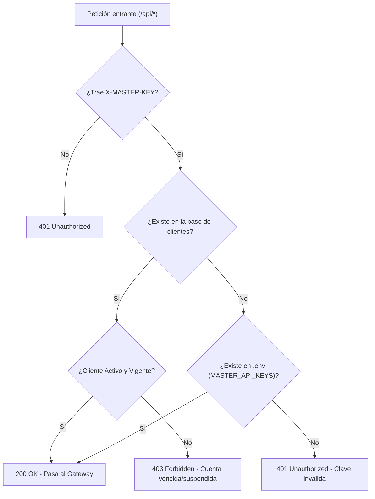

# Manual del Panel de Administración (Mk WhatsApp API)

Guía completa sobre las funcionalidades, arquitectura y operación del **Ambiente de Administración** (`/admin` y `/api/admin`) de **Simple-Whatsapp-API**.

---

## 1. Visión General del Panel

El **Ambiente de Administración** es un centro de control web protegido diseñado para gestionar clientes, suscripciones, claves de acceso API y control de pagos para la plataforma de mensajería WhatsApp.

- **URL de acceso**: `https://<HOST>/admin` (o `http://localhost:3000/admin`)
- **API administrativa**: `/api/admin/*`
- **Seguridad**: Autenticación mediante tokens de sesión basados en HMAC y credenciales seguras de `.env`.

---

## 2. Acceso y Autenticación

El acceso al panel se encuentra restringido a usuarios con rol administrativo:

1. **Credenciales en `.env`**:
   ```env
   ADMIN_USER=merke
   ADMIN_PASSWORD=TuContraseñaSegura
   ```
2. **Generación de Token de Sesión**:
   Al autenticarse en el formulario de inicio de sesión (`POST /api/admin/login`), el servidor valida las credenciales y devuelve un token firmado con expiración (24 horas).
3. **Persistencia de Sesión**:
   El token se almacena de forma segura en `sessionStorage`/`localStorage` y se envía en la cabecera `Authorization: Bearer <TOKEN>` en cada petición administrativa.

---

## 3. Planes y Perfiles de Suscripción Oficiales

El sistema cuenta con 3 perfiles oficiales editables y configurables dinámicamente desde el panel:

| Plan | Tarifa Mensual | Límite de Sesiones | Límite Mensual de Mensajes | Características Destacadas |
| :--- | :---: | :---: | :---: | :--- |
| **Developer** | **$19 USD** | 1 Sesión | **2,000 msgs/mes** | Ideal para desarrolladores y pruebas, webhooks, Swagger interactivo. |
| **Business** | **$29 USD** | 3 Sesiones | **4,000 msgs/mes** | Para PyMEs y comercios, mensajes masivos y encolado, soporte prioritario. |
| **Enterprise** | **$59 USD** | **Ilimitadas** | **Ilimitado** | Grandes empresas & SaaS, alta concurrencia, balanceo y SLA 99.9%. |

> **Modificación Dinámica de Planes**: Tanto las tarifas ($ USD) como los límites de mensajes y sesiones de cada plan pueden modificarse directamente en la sección **"Planes de Servicio"** del Admin. Cualquier cambio se guarda en `data/plans.json` y se refleja de inmediato en la landing page (`index.html`), las reglas de la API y los cálculos de pago.

---

## 4. Funcionalidades Principales del Admin

### 4.1. Dashboard y Métricas en Tiempo Real
- **Resumen de clientes**: Conteo de clientes totales, activos, por vencer (< 5 días), vencidos y suspendidos.
- **Métricas de facturación**: Total histórico recaudado y total del mes actual en USD.
- **Acceso rápido**: Creación ágil de clientes y registro inmediato de pagos.

---

### 4.2. Directorio y Gestión de Clientes
- **Registro de nuevos clientes**:
  - Nombre o Razón Social.
  - Correo electrónico y teléfono de contacto.
  - Selección de plan (Developer, Business o Enterprise).
  - Fecha de vigencia inicial.
- **Estados calculados en tiempo real**:
  - 🟢 **Activo**: Cuenta con vigencia al día.
  - 🟡 **Por vencer**: Faltan 5 días o menos para el vencimiento.
  - 🔴 **Vencido**: La fecha de expiración ha pasado.
  - ⚫ **Suspendido**: Bloqueado manualmente por el administrador.
- **Edición y suspensión**: Modificación de datos de contacto, cambio de plan y bloqueo/desbloqueo instantáneo.

---

### 4.3. Administración Dinámica de API Keys por Cliente
Cada cliente puede tener múltiples claves API asociadas a diferentes sistemas o departamentos (ej. *CRM*, *Sistema de Facturación*, *E-Commerce*):

- **Generación aleatoria segura**: Prefijos tipo `key_<nombre>_<random>`.
- **Control granular**:
  - Activar o pausar claves individuales sin eliminar al cliente.
  - Revocación y borrado permanente de claves obsoletas.
- **Validación instantánea**: Cualquier cambio de estado de una clave se refleja de inmediato en el gateway de mensajería.

---

### 4.4. Webhooks para Mensajes Entrantes y Eventos
Cada cliente puede tener asignada una URL de Webhook y una clave secreta para recibir eventos HTTP POST en tiempo real:
- **Eventos soportados**:
  - `message.received`: Notificación instantánea al recibir un mensaje en WhatsApp (texto, audio, imagen, documentos).
  - `session.ready`: Sesión conectada y lista.
  - `session.disconnected`: Notificación de desconexión.
  - `session.qr`: Nuevo código QR generado.
- **Seguridad HMAC**: Cabecera `X-Hub-Signature-256` firmada con SHA-256 para validación de origen.
- **Prueba en Vivo**: Botón "Probar Webhook" en el directorio de clientes para verificar conectividad y respuesta HTTP inmediatamente.

---

### 4.5. Control de Límites y Consumo de Mensajes
- **Plan Developer**: Tope mensual de **2,000 mensajes** (o el valor personalizado en Admin). Al superar el límite, la API responde con `429 Too Many Requests`.
- **Plan Business**: Tope mensual de **4,000 mensajes** (o el valor personalizado en Admin).
- **Plan Enterprise**: Mensajería ilimitada.
- **Barra de Progreso en Tiempo Real**: Visualización gráfica del consumo mensual y reinicio automático al comenzar cada mes.

---

### 4.6. Edición y Personalización de Planes y Tarifas
- En la sección **"Planes de Servicio"**, el administrador puede hacer clic en **"Modificar Tarifas & Límites"** para actualizar precios mensuales, topes de mensajes, número de sesiones y lista de características.
- Los cambios se aplican en caliente a toda la plataforma sin necesidad de reiniciar el servicio.

---

### 4.6. Control de Pagos y Extensión Automática de Vigencia
- **Registro de pagos en USD**:
  - Monto recibido ($ USD).
  - Método de pago (*Transferencia, Tarjeta, Stripe, PayPal, Efectivo*).
  - Número de comprobante o referencia bancaria.
  - Notas u observaciones de la transacción.
- **Extensión automática de vigencia**:
  - Al registrar un pago, el sistema calcula automáticamente los meses/días correspondientes según la tarifa mensual del plan del cliente y añade dicho tiempo a su fecha de vencimiento (`validUntil`).
- **Historial auditable**: Listado detallado de todas las transacciones procesadas con fecha y hora.

---

## 5. Integración con la Seguridad del Gateway (`masterAuthMiddleware`)

El middleware `masterAuthMiddleware.js` aplica una **doble capa de validación**:



1. **Clientes del Admin**: Si la clave pertenece a un cliente registrado, verifica que su estado no sea `suspendido` ni `vencido`. Si la cuenta expiró, la API rechaza las peticiones con código `403 Forbidden` indicando la causa.
2. **Fallback `.env`**: Si la clave no está en la base de datos de clientes, valida contra las claves maestras fijas definidas en `.env` (`MASTER_API_KEYS`).

---

## 6. Experiencia de Usuario y Reglas de Interfaz (UI/UX)

- **Notificaciones Sticky**: Toda operación exitosa (guardar cliente, generar clave, registrar pago) despliega notificaciones flotantes en la esquina superior derecha sin bloquear la interacción.
- **Modales de Confirmación**: Cualquier acción destructiva (eliminar cliente, suspender servicio, revocar clave API) requiere confirmación explícita mediante un modal interactivo en lugar de alertas nativas del navegador (`alert()` / `confirm()`).
